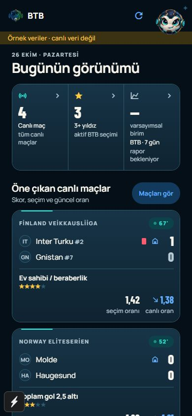
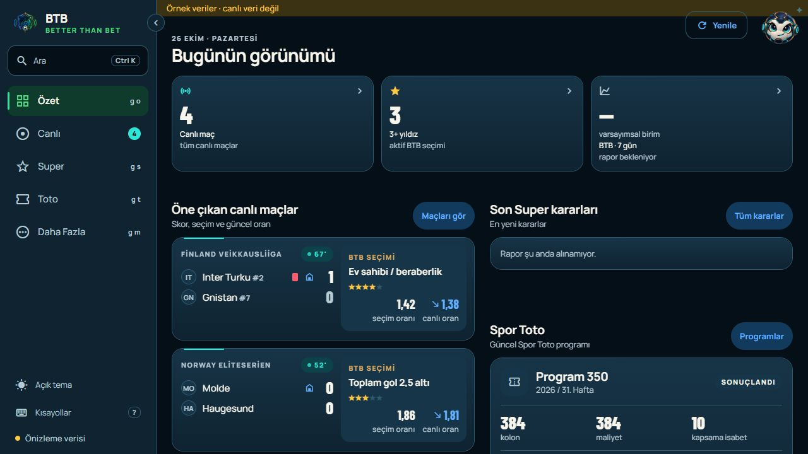

# Combined client UX release — 2026-10-26

Scope: NXT-OBS-223 direct pilot entry, NXT-OBS-224 Summary UX, NXT-OBS-225 Live UX
and the web focused-resize repair. Owner: BTB Mobile Next - Aktif.
Status: WEB_PUBLISHED / ANDROID_ACCEPTED / OWNER_WEB_SMOKE_PENDING.

The owner requested removal of the pilot welcome screen followed by publication
of all these changes. Android and web publication intent is explicit. This does
not create an installation receipt or complete the separate Git/signing gates.
The owner subsequently explicitly approved the presented combined preview,
scoped `zbet-mobile` and `btb-codex` commit/push, ARM64 APK build/signing and
private delivery on 26 October. The existing Android/web publication approval
remains in force. Owner confirmed exact installation and Android basic smoke:
“APK sorunsuz devam et”. The companion web is published; its owner smoke is the
only remaining acceptance item before the paired completion gate.

## Delivered pair

Release source: `3279a25db729c9e6f7234f6a08998bad5a162d77`.
Batch: `client-3279a25db729c9e6f7234f6a08998bad5a162d77-E7CF451CE293-AA91DA90DFE6`.

- Signed ARM64 APK, 50,476,069 bytes, verified pilot certificate and ABI;
  [private exact APK](https://drive.google.com/file/d/1JB2HwJb0Zqa4KqNQyNGXZY5PmSjV6wTM/view?usp=drivesdk).
  Owner-only permissions and authenticated downloaded bytes/hash verified.
- APK SHA-256: `E7CF451CE293B06FED5249A2602F9A5670B01C883438184DD145F9C32C6D54AC`.
- Canonical paired web tree: `AA91DA90DFE6C02E9C3BA6C3788FD2D0DE50B5DC6CE9851D3BFC57CD9C79E2C1`.
- Web publication: `20261026T091317Z-3279a25` on `app.surklase.com`, after owner
  installation. Local/public health, shell/deep-link/CSP, API401, Access302 and
  served entry bytes pass. Served entry SHA-256 is
  `ED7929E1C044266AE90B41404497B9E12C8D56736F2280ACD79499C337B96CD8`.
- Android owner smoke passed; published-web owner smoke is unobserved. Retain
  TASK-0180 and batch completion as pending. Durable receipts:
  `btb-codex/docs/evidence/client-release-3279a25-*2026-10-26.json`.

## Reviewable candidate

Pilot bootstrap now opens the app directly after its existing launch animation.
The former entry button established no identity; the pilot API credential checks
are unchanged. Preview stays direct, web retains Cloudflare Access and direct
edge entry, and OAuth still requires its own session bootstrap. Existing OAuth
sign-in and error flows are retained. Both surfaces include the accepted Summary
improvements and the locally validated Live improvements.

Checks: type/lint, 669 client tests, 32 tooling tests and brand checks pass.
The pilot bootstrap regression test now expects direct entry while checking the
separate OAuth bootstrap. A temporary synthetic preview mounted the real
AuthProvider in pilot mode: Summary appeared, with zero pilot-entry buttons.
No pilot credential was used or copied for that preview. The test route is
removed. Android JS bundle and verified edge web export pass; web secret scan
passed for 4 scannable files. Prior Doctor 20/20 remains applicable to unchanged
dependencies/native configuration.

Candidate outputs (not release artifacts):
`expo-app/.codex-artifacts/combined-client-ux-20261026/android` and `web`.
These pre-commit validation outputs are separate from the signed released pair
above. Owner-attested basic Android smoke does not establish TalkBack,
performance or native orientation coverage.

See [Summary review](SUMMARY_UX_REVIEW_2026-10-26.md) and
[Live review, comparisons and resize proof](LIVE_UX_REVIEW_2026-10-26.md).

## Approved sequence (steps 1–4 delivered; step 5 pending)

1. Accept the combined preview and explicitly approve scoped commit/push in
   `zbet-mobile` (client, tests, documentation and retained preview evidence)
   and `btb-codex` (TASK-0180's scoped register record), plus final ARM64 APK
   build/signing and owner-only delivery. No `zbet-cap` change is required.
2. Recheck Git status/diff, commit only this batch, push, and freeze the clean
   client SHA. Rebuild and verify web from that SHA, then build/sign a uniquely
   named APK with `build-pilot-apk.ps1` from the same source. Verify the pair
   with `client-release.mjs` before either delivery.
3. Deliver to the existing private owner-only Drive folder and verify the
   downloaded bytes, signature and ABI. Obtain actual owner installation proof.
4. After installation, run the publisher dry run, publish the companion web
   under the owner's publication approval, and verify local/public gates.
5. Record actual Android and published-web smokes; only matching receipts can
   complete the coordinated batch. TASK-0180 stays open until that work closes.

The previous completed pair remains the recovery baseline: client source
`57e27c219530fa449dd66f769cdff613d94d7a2b`, APK `F0828E2B1948…`, web tree
`CED99092AA3B…`, web release `20261025T124608Z-57e27c2`. Exact prior receipts are
in the active handoff; prior artifacts and web release directory are retained
while the new paired release is active.

Approval sources: workspace `AGENTS.md` Git Operations and Mobile hard rules;
`COORDINATED_CLIENT_RELEASE.md` requires accepted web preview before final APK
and actual installation before companion web publication. The registered
publisher restarted the unchanged BFF for the approved web-root switch; no
production, model, SAP, credential or Cloudflare Access-policy change was made.
