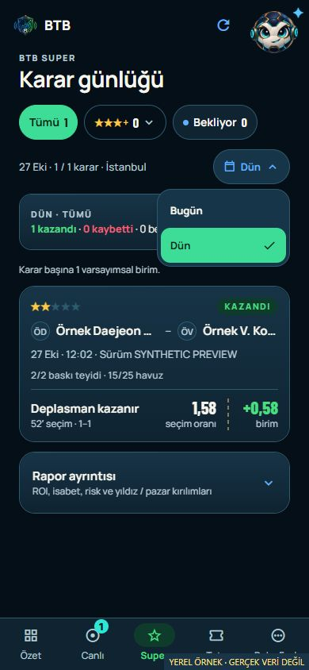

# Daily decision report — 28 October 2026

Owner request: replace the 7/30-day decision log with Today and Yesterday to
reduce SAP read load. TASK-0200 / NXT-OBS-232. Local implementation only.

The default is Today. Both daily periods use Europe/Istanbul publication dates,
including UTC midnight offsets and year boundaries. Android and desktop web
share the menu, records, filters and totals. Jinx, Overview and the Android
widget now show Today and reuse the same daily HTTP request; a weekly mounted
consumer no longer starts a wide history read. Widget day metadata and native
label support one day. Legacy widget payloads remain readable.

`X-BTB-Report-Periods: recent-days.v1` opts into two keyed one-day periods.
The BFF filters `RebuildOpportunities.created_at` using actual OData
DateTimeOffset bounds before reading proofs. It retains full histories only
for selected fixtures, so predecessor links and all result revisions remain
verified. PREPARED guards remain global, and both discovery and fixture state
are reread for snapshot consistency. There is no cross-request proof cache.
Daily `learning` is null; a two-day display never substitutes for whole-history
learning evidence. Legacy report clients retain their existing contract.
No SAP activation, model/result rule change, archive deletion or WSL change.

| Local direct OData measurement | Previous full report | Daily report |
| --- | ---: | ---: |
| Source requests | 62 | 14 |
| Proof-part requests | 32 | 3 |
| Proof parts | 23,067 | 2,388 |
| Proof wire bytes | 24,760,917 | 2,562,686 |
| Reader time | 2,795 /3,014 ms | 622 ms |
| Returned decisions | 92 | 10 (1 Today /9 Yesterday) |

All ten daily records are deeply identical to the same records in the prior
full report, including exact quotes, source evidence and settlement results;
the new DTO passes the strict shared client schema. These are warm-source local
measurements against real OData, **not sap-adt MCP**, activated API latency or
permanent HANA capacity proof. The initial integer timestamp probe failed;
actual OData timestamp typing was checked and the final DateTimeOffset filter
succeeded. No database/configuration mutation was used.

Validation: 701 client and 679 BFF tests; TypeScript; ESLint (final changed-file
recheck clears two duplicate-import warnings); CAP production build; Android
JS/Hermes preview export; canonical verified edge web export; native widget
Java/resource compilation. Unchanged dependency Doctor20/20 reused. Synthetic
desktop and 390/320 px browser checks cover only Bugün/Dün options, switching,
Enter activation, correct daily dates/outcomes and empty-day recovery. No
actual owner-device or published-web smoke is claimed.

[Desktop menu](evidence/DAILY_REPORT_2026-10-28/desktop-menu.png) ·
[Validation receipt](evidence/DAILY_REPORT_2026-10-28/validation-receipt.json).

Owner approved scoped Mobile/CAP Git/push, exact-source DEV BFF activation,
APK signing/private delivery and companion web publication on 28 October.
This is the validated pre-execution checkpoint. The prior ed3dbf8 private APK
and matching web export are retained; the revised scope needs a new coordinated
Android/web batch. Accepted published pair 9d87b2e remains active. CAP must
support the new header before client delivery. Actual installation and both
client smokes are required before completion. No production is authorized.
