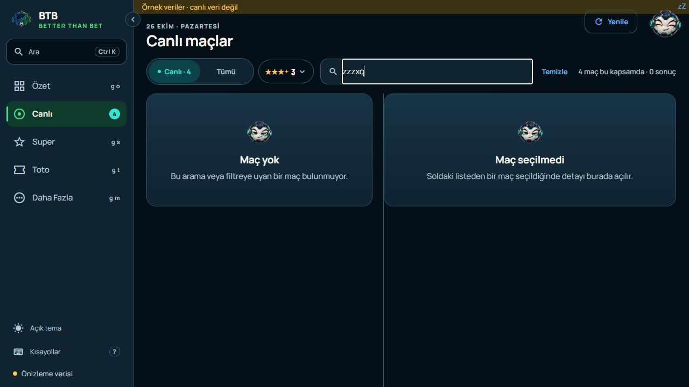
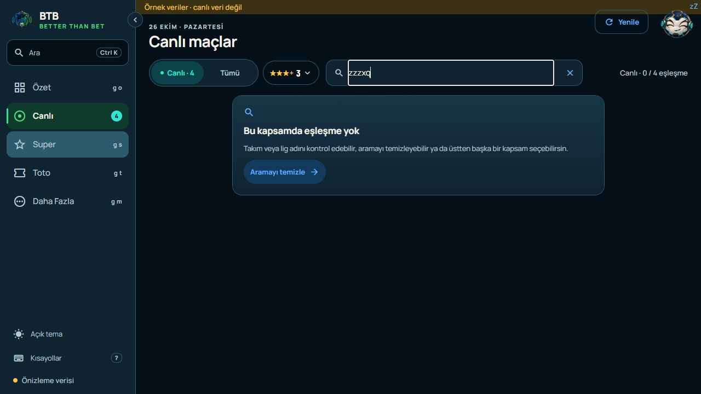
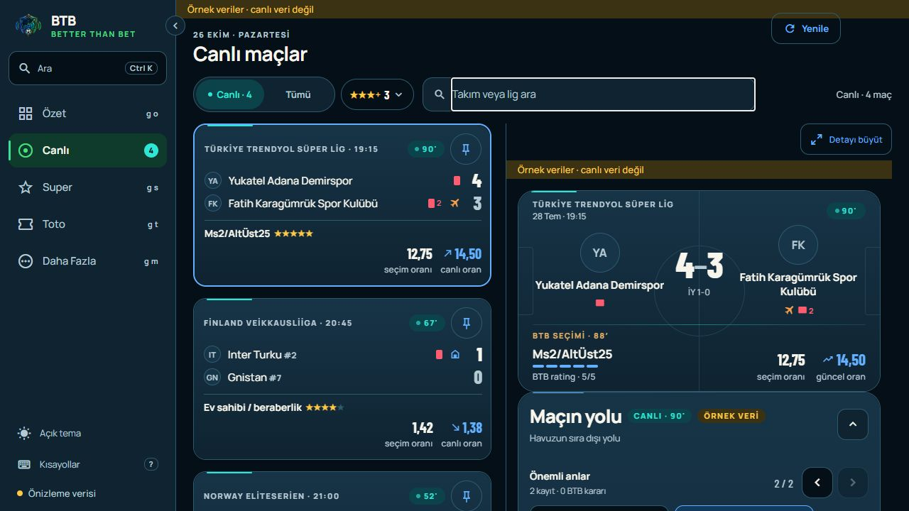
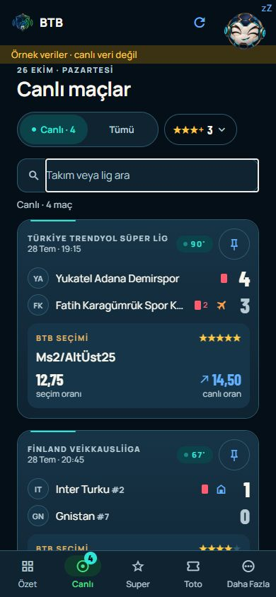
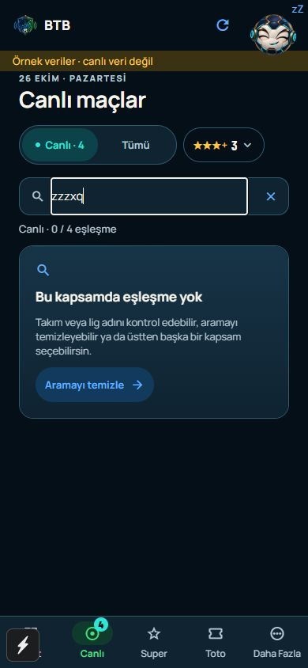
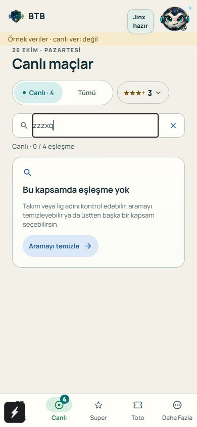

# Live UX review — 2026-10-26

Owner: BTB Mobile Next - Aktif. NXT-OBS-225; recurring JURY-R02 / TASK-0180.
Status: COMPLETE; Android and published-web owner basic smokes accepted; paired completion gate passed.
Published in the [combined 3279a25 pair](COMBINED_CLIENT_UX_RELEASE_2026-10-26.md).

The owner accepted the Summary preview and explicitly requested the same expert
assessment and meaningful local implementation for Live on Android and web.
NXT-OBS-223 welcome-screen removal shipped in the same accepted pair.

## Assessment and changes

Initial heuristic score **7.5/10**; local candidate **8.5/10**. These are expert
judgements, not user-study measurements. The match cards and desktop split detail
already provide useful scanning and comparison. Changes address confirmed
recovery, status and responsive interaction problems:

- One actionable empty state replaces the desktop's duplicate “no match” and
  “select a match” panels. Search misses are distinct from no fixtures, no live
  matches, an empty star threshold, loading and unavailable selection records.
- Empty states clear search, open a populated Live/Fixture scope, or refresh.
  With no matches in either scope, refresh is offered instead of a loop between
  empty views. Missing selection evidence never becomes a measured zero.
- Counts name the current scope. `Tümü` retains its owner-approved label while
  the count line clarifies `Fikstür`. The search clear control stays inside the
  field, has a 44 px target and does not resize the field when text is entered.
- Search Escape clears text while preserving the selected match. An expanded
  detail remains expanded; a subsequent Escape restores the split view.
  Android has the shared touch clear/recovery controls; desktop adds keyboard
  operation. Existing matching, pinning, star and quote eligibility are retained.
- Pull-to-refresh uses the general active-query allowlist, including visible
  match-detail data and the publication report. Only a manual refresh drives its
  spinner; a failure receives feedback. Manual analyst queries stay excluded.

## Confirmed web resize recurrence

The accepted JURY-R02 repair from 23 October was insufficient for focused search
resizing. On the current source, Live's heading stayed at **x=-41 px** in a
320 px viewport, with part of Super visible. The page strip's transform was
correct, but its hidden-overflow ancestor retained **scrollLeft=65**.
Evidence: `evidence/LIVE_UX_2026-10-26/resize-recurrence-before.jpg`.

The web-only root tab viewport now uses CSS `overflow: clip`, which prevents the
focus-driven scroll offset. The browser pager preserves search focus on width
changes; route changes still dismiss the prior page's input. Android retains its
native pager. Routes are not remounted, preserving search, filters and selection.
See [MDN's overflow reference](https://developer.mozilla.org/en-US/docs/Web/CSS/Reference/Properties/overflow)
for the difference between hidden scroll containers and non-scrolling clipping.

TASK-0180 is reopened under the owner's concrete-recurrence rule, scoped to this
repair and its new acceptance. The 23 October delivery and accepted client pair
remain historical; they are not retroactively failed or re-certified.

## Verification

- TypeScript, ESLint, 669 client tests (four new state-priority regressions),
  32 tooling tests and brand checks pass on the final shared-navigator source.
- Expo Doctor 20/20 is reused from the Summary batch on the same unchanged
  dependencies, native configuration and preview environment.
- Synthetic browser scenarios: populated fixture + search miss + clear;
  unavailable selections + Live recovery; selection loading + search priority;
  unknown counts during match loading; empty star threshold; no live matches +
  fixture recovery; empty schedule + refresh. Temporary scenario route removed.
- Search field width before/after typing: **468.65625 / 468.65625 px** at 1280.
  Clear target: **44×44 px**; recovery action height: **44 px**.
- Final focused resize sequence **1440→390→320→768→1440→390→320→1440** retains
  `molde`, input focus and zero clipping-container offsets. Phone heading origin
  is **24 px** at 320/390. See
  `evidence/LIVE_UX_2026-10-26/focused-resize-proof.json`.
- Primary web navigation (Summary, Live, Super, Toto, More), star-menu Escape,
  search clear, selected-match preservation and expanded-detail Escape checked.
  Dark/light and 320/390/768/1280/1440 widths inspected; no preview console errors.
- Final Android bundle and verified edge web export pass. Web verification
  confirms edge configuration and a clean secret scan (4 scannable files).
  The temporary scenario route is absent from source and the final web bundle.
  Existing published `dist-web` was not overwritten.
- Native device smoke, TalkBack, physical pull gesture and orientation are
  unverified. Browser preview preferences and default viewport were restored.
- Commit/push, signing/distribution and coordinated publication are pending
  their own explicit approvals. Existing published APK/web pair is retained.

Local outputs: `expo-app/.codex-artifacts/live-ux-20261026/android` and `web`.
They validate an uncommitted candidate, not a signed coordinated release pair.

| Artifact | SHA-256 |
| --- | --- |
| Android `index-465f3884cf994aebb81b17f5b2fbacc4.hbc` | `A1F317F71A21F517EB90B90D627A6CEF25CB7EB8901BCE62E60BB4C5B860F1AA` |
| Web `index-2ca2e70493c8cd8a816daee66f7590cd.js` | `2474294D11150DA37506102CDC597823BA8F7A9F23C5E53CF93DE1A651DD6090` |

## Local preview evidence

All pictures are synthetic local previews, not live SAP or owner-device evidence.

