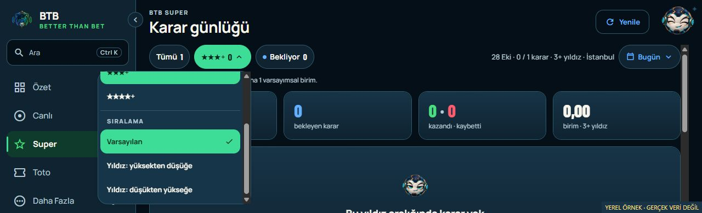
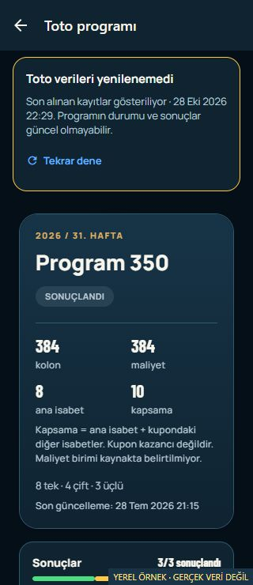

# Principal UX implementation — 28 October 2026

Owner: BTB Mobile Next - Aktif. NXT-OBS-233.
Status: LOCAL IMPLEMENTATION AND VALIDATION COMPLETE / NOT COMMITTED OR RELEASED.

Release authorization received after this checkpoint: on 28 October the owner
approved scoped commit/push and the coordinated pilot Android/web publication
(“commit push ve yayın yapabilirsin”) after seeing the validated web preview.
The release will use one clean pushed source; private delivery/actual installation
and both owner smokes remain evidence gates. Current release receipts belong in
`btb-codex/docs/evidence/principal-ux-release-*2026-10-28.json`. The original local
validation and its uncommitted artifact hashes below remain historical.

The owner approved all six recommendations from the
[principal UX review](PRINCIPAL_UX_REVIEW_2026-10-28.md). This batch implements
those recommendations locally on the shared Android/web client. The accepted
`260bd57` Android/web pair remains installed/published; this is a separate,
uncommitted candidate based on `4b2bd7c`.

## Changes

| Item | Result | Surface coverage |
| --- | --- | --- |
| UX-01: consistent live count | Summary, navigation and Jinx use the same current match snapshot policy. LIVE and HALF_TIME count; a verified empty list gives zero. Loading or failed reads give unknown rather than an invented zero or stale dashboard total. | Shared Android/web. Existing desktop polling is preserved; passive badge observers do not start new polling. |
| UX-02: contained star/sort menu | Safe-area-aware measured menu placement, upward opening where useful, constrained scrolling, and remeasurement after resize/rotation/font-scale changes. Existing 44-point option targets remain. | Shared component for Android/web; browser short-window and phone-landscape checks passed. Native rotation remains unobserved. |
| UX-03: operable desktop search | The arrow-selected result scrolls into view. Input/list/options have combobox/listbox/option semantics, active descendant and explicit selected state. Empty results have a live status outside the listbox. | Desktop web; Android retains its existing direct list search. No request is added when opening the palette. |
| UX-04: retained Toto reading context | Transient failed refresh leaves cached list/detail readable with a fixed, timestamped warning and retry. Success clears the warning. Initial failure and session/access loss or authoritative 404 still use the full error state. | Shared Android/web; list/detail failure and successful recovery checked in the exported web app, including 320px detail. |
| UX-05: accessible native reorder | “Bölümleri düzenle” exposes named/positioned 44-point Up/Down controls, disabled boundaries and spoken new position. Existing persisted order callback is reused. Scrolling remains available while editing; hold/drag remains outside edit mode. More guidance is updated. | Android-specific. Desktop retains its existing reorder arrows. Actual TalkBack and touch interaction remain unobserved. |
| UX-06: widget target size | Notification-widget action row increases from 40 to 48dp. Minimum/default height increases from 120 to 156dp and minimum resize height from 100 to 156dp to retain header/body space. | Android-specific. Web navigation already provides the same destinations. Existing compact widget placements may need resizing or re-adding after a future delivery, depending on the launcher. |

## Validation

The canonical Mobile quality gate passed: TypeScript, ESLint, client tests,
tooling tests, brand checks and Expo Doctor. Eighteen new focused regression
tests cover count transitions/unknowns, retained query data/access loss/recovery,
menu geometry, selected-row visibility and accessible module moves/persistence.
An independent review of the count, Toto, menu and search changes found no
material regression. The native reorder implementation was also inspected by
the root agent; that is source review, not a native usability test.

The first rendered search check found that React Native Web did not forward
the selected-state prop as `aria-selected`. Explicit web `aria-selected` fixed
this. Scoped TypeScript/lint checks passed after the fix, and both final client
exports were rebuilt. The final DOM confirmed a linked active option with
`aria-selected="true"`, input focus retained and the entire option visible.
The full test/Doctor results above were reused for that one attribute change.

| Exported-app scenario | Observed result |
| --- | --- |
| Super menu at 1280×390 | Menu stays within y=130–374; internal scrolling reveals and activates the final sort option. |
| Super menu at 640×320 landscape | Menu stays within y=180–304; final 44px sort row is reachable at y=255–299 and activates successfully. |
| Search with 16 cached live fixtures | Twelve Down presses select index 12, scrollTop 256; active option stays visible and input remains focused. |
| Empty search / Enter / Escape | Empty status appears with no active descendant; Enter does not navigate. Escape closes and restores prior focus. Searching Super and Enter opens `/super`. |
| Match ends while foregrounded | The current list becomes empty; Summary changes to 0 and navigation has no positive badge. Baseline source kept Summary at 1 in the same scenario. |
| Match reads fail while dashboard says 1 | Summary displays `—` and “doğrulanamıyor”; no positive navigation badge is shown. |
| Toto list success→failed refresh→retry | Card/filter context remains with warning and original client receipt time; successful retry removes the warning. |
| Toto detail success→failed refresh→retry | Program and three prediction rows remain readable. At 320 px, warning is within x=16–304 and page width remains 320 px. Successful retry removes the warning. |
| Initial Toto read fails with no cached program | Full error state appears, with no retained-data warning; no invented empty result is shown. |

Screenshots/geometry records are in
`docs/evidence/PRINCIPAL_UX_IMPLEMENTATION_2026-10-28/`.
The isolated synthetic harness blocks external fetches and non-read methods;
it sends no real SAP/BFF request. It uses the actual exported client screens,
not a separate mockup. Checks before the final ARIA attribute change remain
applicable to the unchanged count/Toto/menu code; final search semantics were
checked against the final export.

## Builds and limits

Final Android preview JS/Hermes export and canonical edge web export passed,
including secret scans. Native widget Java/resource compilation passed for the
ARM64 validation target. Gradle reported its existing deprecation notice; no
compile failure occurred. There is no new signed APK or delivery artifact.

| Local artifact | SHA-256 |
| --- | --- |
| Android preview Hermes bundle | `DD8F167BBE922F8F4EE31D4F92FBF6492F54E6C28E2909724D7D35F0284B275C` |
| Verified edge web asset tree | `70E2199BDF8E62E31E67182E0F15870AD96AF1770CAF624FB738F439D0E532AD` |

These exports describe dirty local candidate source, not a clean pushed release
pair. Their functional source hashes and tool receipts are retained under
`.codex-artifacts/principal-ux-fixes-20261028/`; the published `dist-web` was
preserved. No BFF/SAP/model, result accounting, star rule, Today/Yesterday scope,
notification routing or external configuration changed.

No connected Android device/emulator was available. TalkBack, native reorder
buttons/drag, physical refresh/swipe, font scaling and launcher resizing are
unobserved. Phone-width browser checks do not substitute for native acceptance.
No new post-change UX score or universal accessibility claim is made.

NXT-OBS-233 is locally implemented and validated; it is not marked delivered.
Stage/commit/push, signing/private APK delivery and companion web publication
remain separate approvals. Any later release must rebuild both surfaces from
one clean pushed commit, verify private APK installation before web publication,
retain the previous pair and obtain both owner smoke acceptances. No recurring
observation task was created.
