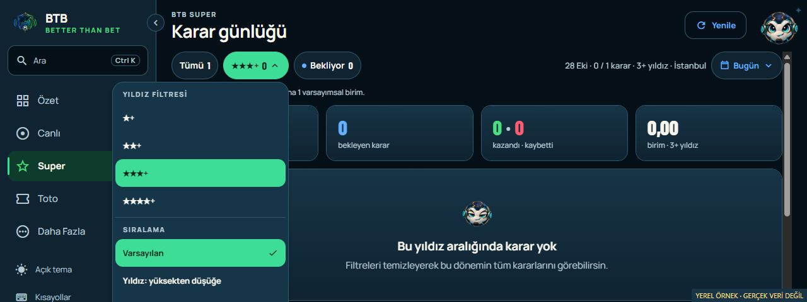
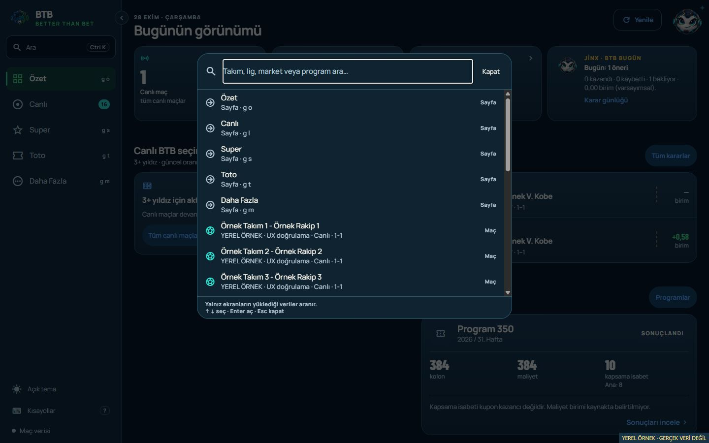

# Principal UX review — Android and desktop web, 28 October 2026

Owner: BTB Mobile Next - Aktif. NXT-OBS-233.
Status: BASELINE REVIEW COMPLETE / FOLLOW-UP LOCALLY IMPLEMENTED.

Follow-up: the owner approved all six recommendations. Their local implementation
and validation are complete in [the implementation record](PRINCIPAL_UX_IMPLEMENTATION_2026-10-28.md);
the assessment below preserves the pre-change findings and evidence. No release occurred.

The product is coherent and useful for the owner's daily pilot workflow. Preserve
the visual identity and current information architecture. Six bounded interaction,
resilience and accessibility improvements are justified; a redesign is not.

## Scores and method

Overall heuristic assessment: **8.2/10**. Desktop web: **8.3/10**. Android:
**8.0/10, provisional**. These are expert judgements, not usability-study results,
measured task success, accessibility certification or model-performance scores.
Differences smaller than half a point should not be treated as meaningful.

The overall score uses the following product-level rubric, rounded to one decimal:

| Dimension | Weight | Score /10 | Assessment |
| --- | ---: | ---: | --- |
| Visual hierarchy and readability | 20% | 8.5 | Clear headings, consistent surfaces, readable contrast and restrained outcome colours |
| Main journeys and navigation | 25% | 8.5 | Five stable destinations; useful desktop split detail and mobile full-screen detail |
| Data meaning and decision context | 20% | 8.5 | Frozen versus current facts, unknown versus zero, reference support versus probability are explicit |
| Refresh, errors and recovery | 15% | 8.0 | Good contextual empty states; inconsistent count refresh and Toto cached-data handling remain |
| Accessibility and operability | 15% | 7.0 | Good contrast/focus foundations; menu, keyboard search and native alternatives need work |
| Personalisation and help | 5% | 8.0 | Disclosure, saved order and Jinx help are useful; Android reorder has no accessible alternative |

| Journey | Score /10 | Main judgement |
| --- | ---: | --- |
| Overview | 8.0 | Strong daily entry point; live metric should share the badge's current count |
| Live list and match detail | 8.5 | Good scan-to-detail flow, price separation and progressive evidence |
| Super journal and decision detail | 8.5 | Clear recorded context and daily scope; short-window menu needs containment |
| Toto list and program detail | 8.0 | Main/coverage distinctions and result filters are clear; failed refresh should preserve reading context |
| More, help and personalisation | 8.0 | Useful controls without unnecessary settings; native order editing needs an alternative |
| Desktop search | 7.5 | Useful cached search, but arrow selection can become invisible and is not linked accessibly to the input |

## Evidence boundary

Released source: `260bd57661ae35bd159e5793003fc42abcbf536a`; reviewed clean HEAD:
`4b2bd7c40a708c12d611ef3876f1c624c15c026b`. Their differences are documentation
only. The existing `dist-web` receipt names the released source and tree
`1B6C41930DEF38943A3DE6B3E9D63E440303F323A0795BC262C023E213A81E20`.

Fresh interaction checks used that existing edge export, served locally with
schema-validated synthetic DTOs. The isolated harness rejects write methods,
blocks external fetches and makes no SAP or real BFF requests. Desktop Overview,
Live split detail, Super filtering/recovery, quick search and the Toto list were
inspected at 1280×720, 1440×900 and a short 1280×480 viewport as applicable.
The short-window and search defects below were reproduced in this bundle.

Source reviews covered all five destinations, both detail types, shared controls,
theme/contrast, keyboard/focus, native back, widgets, module ordering and parity.
Retained 26–28 October synthetic phone previews were visually inspected for
Summary, daily Super, contextual Jinx, Toto overview/results and match evidence.
They are prior evidence, not new phone-width interactions in this review. The
older Summary picture's seven-day label has been superseded by Today in source.

`adb devices -l` returned no connected device or emulator. The current pair's
owner-accepted basic Android/web smokes remain valid historical evidence; this
review adds no physical Android, TalkBack, native gesture or font-scale smoke.
The browser connection stopped responding during the attempted Toto refresh
check. Therefore that failure transition, the dynamic count transition, fresh
320/390px interaction, light-theme interaction and remaining detail navigation
were not completed interactively. No successful result is inferred from an
attempt. The temporary viewport could not be reset after the connection failed.

## Improvements with a material benefit

All six are medium-priority maintenance candidates. No critical core-journey
failure was observed in the tested cases; this is not proof that none exists.

### UX-01 — Keep the live count consistent across the screen

**Both surfaces; confirmed source behaviour, transition not reproduced here.**
Overview displays `dashboard.liveMatchCount` at
`app/(tabs)/index.tsx:139`. `dashboardQuery` has a 30-second stale time but no
polling (`src/api/queries.ts:54`); `matchesQuery` polls every ten seconds at line60.
Navigation already derives its badge from the matches cache via
`src/api/use-live-match-count.ts:11`. Stale time alone does not schedule a fetch.
Mounted tabs can consequently show an old Overview count alongside a refreshed
badge/list after a match starts or ends.

Use the same current list/count policy for Overview and navigation, with explicit
loading/unavailable treatment. Validate LIVE→finished and fixture→LIVE while
remaining foregrounded, including half-time policy. No SAP/model change is needed
for this proposed display correction. Synthetic count mismatches from the busy
search fixture are deliberately excluded as runtime proof.

### UX-02 — Contain the star/sort menu within available height

**Shared component; reproduced on desktop web.**
`src/components/DecisionFilterChip.tsx:141` always places the menu below the
trigger; only width is constrained. There is no viewport-height clamp, upward
placement or internal scrolling. At 1280×480 the menu was 387px tall, from
y=130 to y=517. Its final sort row occupied y=468–512, mostly below the viewport.
A wheel attempt left menu top, menu scrollTop and page scroll unchanged.

Clamp against safe available height and provide scrolling, flipping placement
where appropriate. Preserve 44px shared targets. Validate short desktop windows,
phone landscape, large text and Android safe areas before claiming native success.

### UX-03 — Keep keyboard search selection visible and announced

**Desktop web; invisible selection reproduced, assistive wiring inspected.**
At `src/web/CommandPalette.tsx:70`, arrows update only the selected index while
focus stays in the text input. The list is capped at 420 px, with 52 px rows. With 16
synthetic live fixtures, twelve ArrowDown presses highlighted index 12 (the eighth
fixture), y=806–858, below the results viewport ending at y=602. The scrollbar
stayed at the top. Enter is wired to open that current result.

The input had no `aria-activedescendant`; rendered result links also had no
`aria-selected`, despite the React Native selected-state prop. Do not claim a
screen-reader failure was physically tested. Keep the active row visible and
connect the input, results and active option using an appropriate accessible
search pattern, with result counts/empty state announcements. Retain Escape,
focus restoration and cache-only search. Android's existing list search remains
the platform substitute.

### UX-04 — Preserve cached Toto content after a failed refresh

**Both surfaces; source and in-memory query-state confirmation.**
`app/(tabs)/toto.tsx:77` and `app/toto/[gcNo]/[version].tsx:131` prioritize
`isError` even when previously loaded data remains cached. An installed React
Query probe confirmed that a rejected refetch retains prior data while setting
status to error. Those branches then replace the program list or detail with an
error screen, losing the owner's reading context during a temporary failure.

Keep last-known program/coupon/results readable with their existing timestamp,
a clear failed-refresh label and retry. Initial-load failure should still use
the full error state. Cached content must never imply current data or new
playability. Overview's retained-content warning is an existing local pattern.
Validate success→failed refresh→retry success on list and detail. Browser failure
injection was attempted but not completed; no interactive pass is claimed.

### UX-05 — Offer Android module reordering without dragging

**Android-specific; confirmed missing source alternative.**
`src/layout/ReorderableModuleList.tsx:142` uses touch hold/move and a pan responder,
without accessibility actions or move buttons. The web version already supplies
up/down buttons (`ReorderableModuleList.web.tsx:121`). More offers reset, not an
alternative means of editing the order.

Add spoken Move up/Move down actions or an accessible edit-order view. Keep the
existing drag gesture. Validate boundary actions, announced new position, order
persistence and scrolling with TalkBack. Desktop's buttons are the existing
substitute; this is not a request to replace them.

### UX-06 — Enlarge Android notification-widget action targets

**Android-specific; confirmed resource sizing, no device mis-tap observed.**
`modules/btb-widget/android/src/main/res/layout/btb_notification_widget.xml:79`
sets the three-action row to 40 dp; its TextViews inherit that height. It is smaller
than the app's 44-point shared token and Android's 48 dp recommendation. Increase native
targets to 48 dp while retaining widget routes and content, then check widget
resizing and large fonts. Desktop navigation already supplies the equivalent
destinations; there is no web widget counterpart.

## Preserve and observe

Keep the brand, five destinations, desktop split view, daily Today/Yesterday
scope, decision ticket and contextual Jinx. Preserve explicit unavailable states,
recorded versus current prices, hypothetical units, reference counts and Toto
coverage semantics. Do not add dashboards, extra AI prose, new navigation or a
wide-history view without a concrete workflow need.

Keep Android large-font bottom navigation, TalkBack traversal, native pull/swipe,
widget resizing and ordinary perceived speed as unobserved scenarios. Fixed tab
height is a stress-test candidate, not a confirmed clipping defect. A browser
width simulation cannot close native acceptance. These limits create no daily
or weekly wait task and reopen no previously accepted delivery.

## Validation, disposition and references

Canonical verification of the existing export passed in edge mode with a clean
secret scan. Both existing palette/action contrast tests passed. The in-memory
cached-query probe returned `status: error` with its synthetic program retained;
the durable JSON records that state, not a browser rendering test. The context
audit after the documentation updates found no broken section/table routes.
No app source,
BFF, SAP, model, runtime configuration, release artifact or published site was
changed. No new APK/web build, commit/push, delivery or publication was performed.
The local synthetic harness was stopped after review; evidence is retained.

The six findings are recorded as one scoped observation, NXT-OBS-233. They may be
considered together at the next owner-invoked local Mobile batch, with Android
and web advancing together. This review does not start implementation or a
release. All other reviewed areas remain in normal observation.

Evidence directory: `docs/evidence/PRINCIPAL_UX_2026-10-28/`; extra screenshots and
the isolated harness: `.codex-artifacts/principal-ux-20261028/`. Geometry JSON
records the two reproduced interaction defects. Tests validate specific colour
pairs, not full accessibility conformance.

Assessment references: [W3C reflow guidance](https://www.w3.org/WAI/WCAG22/Understanding/reflow.html),
[W3C accessible input/selection pattern](https://www.w3.org/WAI/ARIA/apg/patterns/combobox/)
and [Android accessibility and 48 dp target guidance](https://developer.android.com/guide/topics/ui/accessibility/apps).
