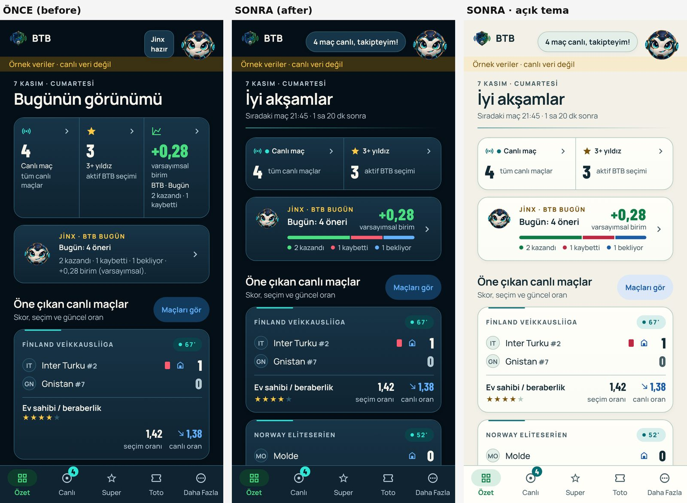
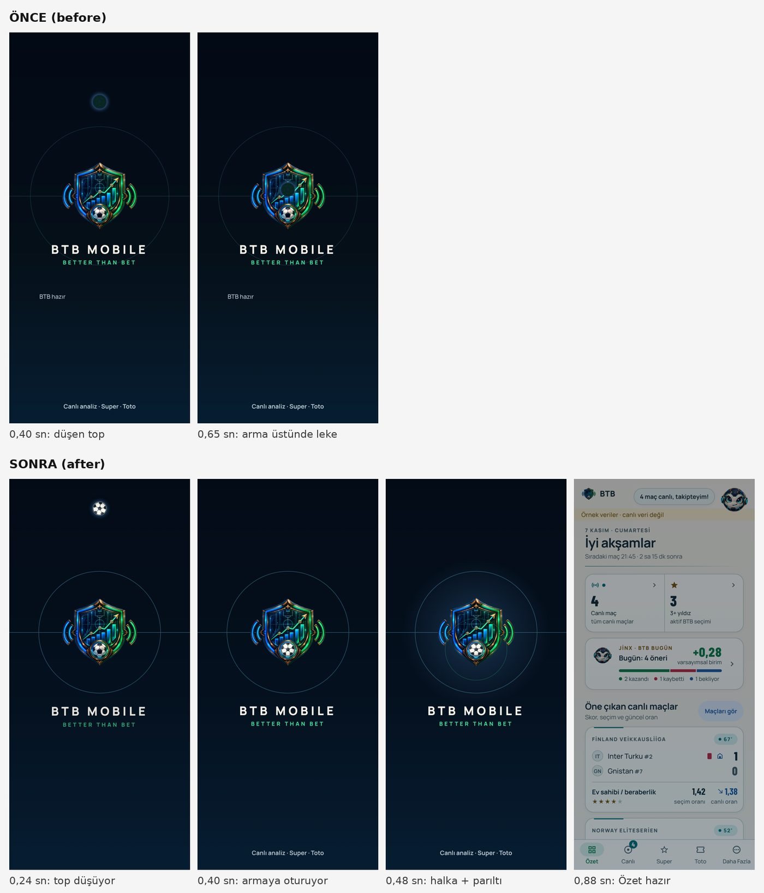

# Splash and Özet experience — 2026-11-07

Scope: shared Android/web launch screen and Özet (Summary) tab.
Status: LOCAL CANDIDATE. Not committed to master, not released, no APK built.

The owner asked for an interaction and enjoyment score for the opening splash
and Özet, rejected quick fixes, and set a target of 9/10 or above. This lens
is about how the screens *feel* (delight, warmth, liveliness, feedback). It is
not the usability rubric of the 26 October Summary review, which already rated
Özet 8.5 for correctness and clarity.

## Scores

Expert judgement with equal weights, not a user study. The same rubric was
applied before and after, at 390×844 with identical synthetic data.

| Splash | Before | After |
| --- | ---: | ---: |
| First look (crest, pitch lines) | 7 | 9 |
| Animation and fun | 3 | 9 |
| Uses the waiting time | 3 | 9 |
| Jinx in the opening | 2 | 8.5 |
| Speed and reduced motion | 9 | 9.5 |
| **Overall** | **4.8** | **9.0** |

| Özet | Before | After |
| --- | ---: | ---: |
| At-a-glance clarity | 7.5 | 9 |
| Warmth and personality | 5 | 9 |
| Feels live | 6.5 | 9 |
| Touch feedback | 5.5 | 9 |
| Empty and quiet states | 5.5 | 9 |
| First-screen content | 6 | 9 |
| **Overall** | **6.0** | **9.0** |

## What changed

Launch (`AppLaunchScreen`, `LaunchBall`, `launch-policy`, `app/_layout.tsx`):

- The ball is drawn in code as a real football. The old ball tinted an icon with
  the action ink on a surface fill, which made a dark disc on dark and a blank
  disc on light. It now falls with gravity, lands exactly on the ball inside
  the crest (measured from `btb-mark.png`), squashes, and settles into it, with
  a centre-circle ripple and a soft crest glow. There is no bounce: a hop
  showed two balls stacked for a moment.
- The timing stays inside the owner's bounded brand moment (800 ms normal,
  500 ms reduced motion). Under reduced motion the brand is static and the swap
  is instant.
- The launch is the brand's night pitch in both themes. This continues the
  native splash (`#04101E`) without the dark-to-light flash light-theme users
  used to get.
- The centre circle no longer cuts through the wordmark, and the left-aligned
  "BTB hazır" is gone. "Uygulama hazırlanıyor" appears only when a start is
  actually slow (after 600 ms).
- Özet's reads (dashboard, matches, report, insights) start under the brand.
  The app mounts beneath the launch, which fades away (brand first, then the
  pitch), so Özet opens filled instead of showing a second loading state.

Özet (`app/(tabs)/index.tsx`, `TodayResultCard`, `MetricCard`, `MatchCard`,
`RefreshToast`, `overview-story`):

- **Header.** A time-of-day greeting with one line about what is next
  ("Sıradaki maç 21:45 · 1 sa 20 dk sonra"), plus the live header trace while
  matches are in play. Screen readers hear "Özet. İyi akşamlar".
- **Jinx greeting.** "Jinx hazır" became a line about what is on ("4 maç canlı,
  takipteyim!"), sized to its words, with a small pop that respects both motion
  preferences.
- **Count tiles.** Two count tiles, each with a breathing live dot. On phones
  the label sits on top and the number sits beside what it counts, which makes
  the strip about 40 pt shorter. Changed figures announce themselves once.
- **Bugün card.** The "BTB · Bugün" tile and the separate Jinx card repeated the
  same wins, losses and units. They are now one Jinx card: the result once, the
  outcome bar from the decision log, and a colour-keyed legend. Its states are
  loading, unavailable with retry, no recommendations yet, and today's result.
  The words come from the same `jinxWeekQuip` as the bubble and "Günlük yorum".
- **Match cards.** On Özet the market and the prices share one row, so the first
  match is complete and the second is in view at 390 pt. A match that has not
  kicked off shows "–" instead of 0–0 (on the Live fixture list too).
- **Quiet and empty states.** With no live matches, the empty state names the
  next fixture and its countdown. Recent decisions gain titled states, with
  retry only where retrying can change the answer. The Toto source note moves
  off Özet, as on the Toto tab.
- **Feedback.** Tiles and cards scale slightly on press. Pull-to-refresh ends
  with a "Yenilendi" confirmation and a success (or warning) haptic. It reports
  the action only, never upstream freshness (NXT-OBS-032).
- **Reorder hint.** The phone reorder hint teaches the gesture until the user
  has their own order, then offers "Düzeni sıfırla" instead.

Kept on purpose: no win celebrations, streaks, mood or money reactions (owner
decision 2026-10-21), and no fabricated freshness or probability.

## Owner decisions this candidate touches

1. The launch is dark (brand) in the light theme too.
2. The Özet heading is a greeting instead of "Bugünün görünümü".
3. The v40 board's third tile and Jinx card are merged. Desktop shows two count
   tiles and a wide Jinx tile.
4. The v40 phone reorder hint is adaptive instead of permanent.
5. Pre-kickoff scores show "–".

## Validation

- `npm run typecheck` and `npm run lint` pass.
- `npm test`: 806/807 pass. The only failure,
  `jinx-match-reading.test.ts` "all supported market truth conditions…",
  requires the sibling `zbet-cap` repository. It fails identically on the
  unmodified source in an environment without that repository.
- New tests cover the launch reveal, choreography and exit, the greeting,
  next kickoff, countdown and story line, and Jinx's opening line.
- `npm run test:tooling` (32 pass, 0 fail) and `npm run check:brand` pass.
- The Android Hermes export (preview profile) and the verified mock web
  export pass.
- Rendered checks in headless Chromium:
  - Widths 320, 360, 390 and 1440, in dark and light.
  - Populated, quiet (no live matches) and unavailable report states.
  - The first-run guide steps (`home-hero`, `home-super-metric`,
    `home-featured`) still land on their targets.
  - The refresh confirmation shows and hides.
  - A fake-clock filmstrip of the normal and reduced-motion launch.
  - Zero page errors.
- Not observed: a physical Android device (haptics, native-driver smoothness,
  TalkBack), or live BFF data. The populated, quiet and toast previews used a
  temporary mock variant that is not part of the change.
