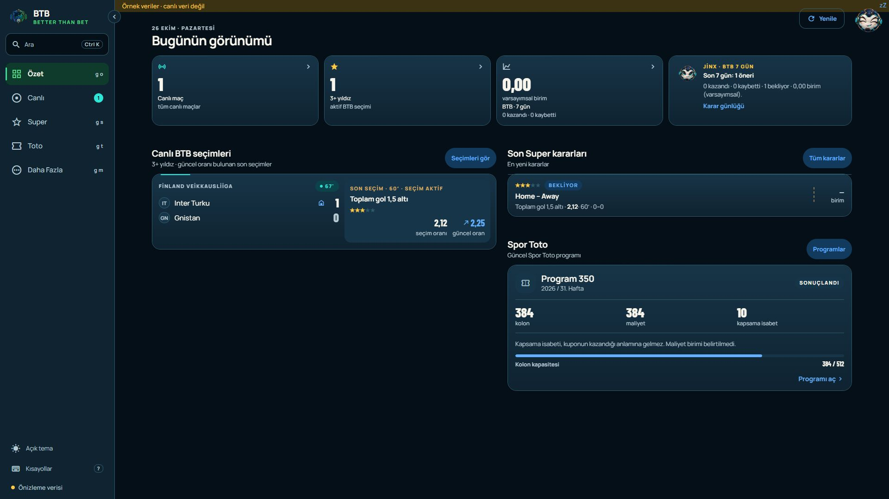
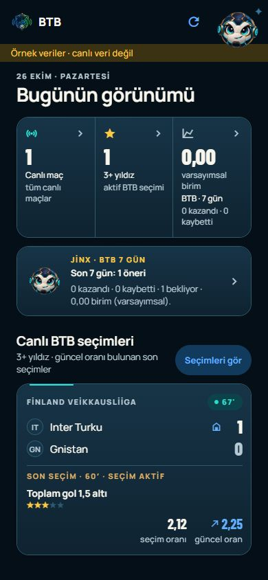
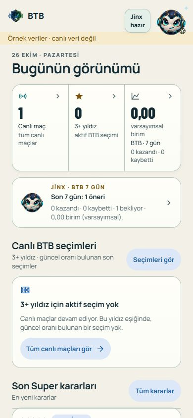

# Summary UX review — 2026-10-26

Owner: BTB Mobile Next - Aktif. Scope: shared Android/web Summary screen.
Status: DELIVERED; Android basic smoke accepted, published-web owner smoke pending.
Published in the [combined 3279a25 pair](COMBINED_CLIENT_UX_RELEASE_2026-10-26.md).
Owner accepted the local preview on 2026-10-26 (approval and “Güzel olmuş”). This
is local design acceptance, not a new Android installation or publication receipt.

The owner explicitly requested an expert UX score and implementation of changes
with a material benefit. This authorizes this bounded local Summary work while
NXT-OBS-223 (pilot welcome screen removal) stays queued for the later batch.

## Assessment

Initial expert heuristic score: **7.5/10**. The established visual identity,
navigation and separation of live activity from historical decisions are strong.
The material weaknesses are ambiguous selection states, an unlabeled result
figure, weak metric navigation cues, cramped three-column desktop composition,
and an incomplete pull-to-refresh scope.

Local candidate score: **8.5/10**, an expert judgement rather than a measured
usability improvement. No user study, native device acceptance or new release is
claimed. Baseline: current source plus the owner desktop image in
`evidence/OWNER_CHART_FEEDBACK_2026-10-24/01-overview.png`.

The review uses [Nielsen's usability heuristics](https://www.nngroup.com/articles/ten-usability-heuristics/)
for status visibility, clear language and recognition, and
[W3C target-size guidance](https://www.w3.org/WAI/WCAG22/Understanding/target-size-minimum.html)
for operable controls. The new recovery action uses the existing 44-point
touch-target token. This is not a complete accessibility conformance audit.

## Implemented

- Separate loading, unavailable data, a live list with no selection at the saved
  star threshold, and no live matches. Remove the generic top-of-page
  no-selection notice; explain the state in the relevant section.
- Give empty states a route to all live matches or the fixture list. Retain the
  saved star threshold and all publication/market/result eligibility rules.
- Label the seven-day result `varsayımsal birim` where the number is displayed.
  Add metric chevrons and destination-specific accessibility hints; use
  `Son Super kararları` and explicit section action labels.
  The recovery button has an explicit spoken label so its decorative arrow is
  excluded from its accessible name.
- Pull-to-refresh uses the same active-query allowlist as the general refresh,
  including the report that supplies seven-day results, recent decisions and
  Jinx. The spinner tracks the manual refresh; failures receive a visible note.
  Manual analyst queries remain excluded by the existing policy.
- Cap Summary at two desktop columns: matches on the left, recent decisions and
  Toto on the right in default order. Saved reorder preferences are retained.
  Android uses the same updated content in its single-column layout; the column
  cap is a desktop layout adjustment.

## Verification

- TypeScript, ESLint, 665 client tests, 32 tooling tests and brand checks passed.
- Expo Doctor: 20/20 passed in isolated preview mode.
- Synthetic RB1 browser checks passed for active, filtered-empty, unavailable,
  loading and no-live states. Unavailable selection count renders `—`, not zero;
  loading does not display a false empty state. The recovery controls resolve to
  `/live?scope=LIVE` and `/live?scope=FIXTURE` as appropriate.
- Phone widths 320 and 390 checked; 320 has no horizontal page overflow. The
  recovery action measures 44 px high. At 1920, recent decisions and Toto share
  the right column, with matches on the left. Dark and light previews inspected;
  preview console had no errors. Browser viewport and dark theme restored.
- Browser screenshots initially timed out; capture worked after continuation.
  The pictures below are saved synthetic previews, not live operational data.
- A temporary local scenario route was removed before final bundles. No preview
  route or fixture modification is part of the implementation.
- Final Android bundle and verified edge web export passed after the final
  accessibility-label change. TypeScript and scoped ESLint were also rerun and
  passed; unchanged behavioural tests and Doctor results above were reused.
- Web verification confirmed edge configuration and passed the secret scan
  (4 scannable files). The temporary scenario route is absent from source and
  the final web bundle. Existing published `dist-web` was not overwritten.
- Native device smoke/TalkBack and actual Android pull gesture: not performed.
  Signing, distribution, commit/push and web publication remain separate gates.

Final local outputs are under
`expo-app/.codex-artifacts/summary-ux-20261026/final-android` and `final-web`.
They validate the uncommitted candidate; they are not a signed release pair.

| Artifact | SHA-256 |
| --- | --- |
| Android `index-ffffe7ae718b5412550920165231dfff.hbc` | `2C8ACC49ABCFE1B1786C7866D8EEF3AC5FEE249D3F178594694AC131AB218996` |
| Web `index-afd4a50e50dd885ebc1927648191b482.js` | `1345A66B57DCC0E4CE1E05004A2A786810251C892BF897AB18A3E153D324BD57` |

## Preview evidence

