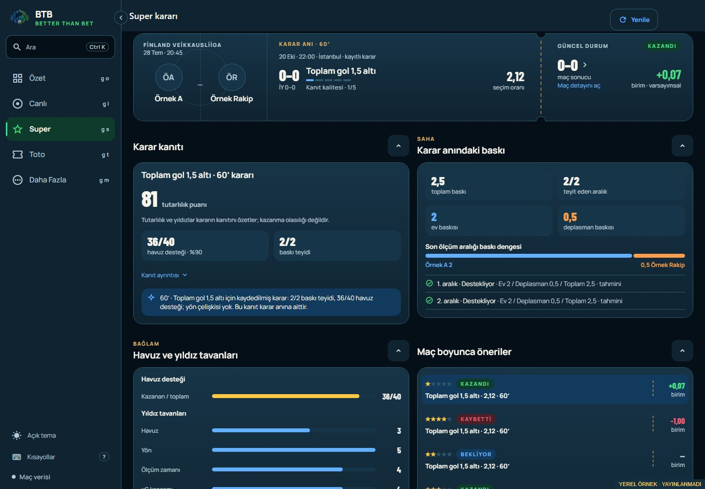
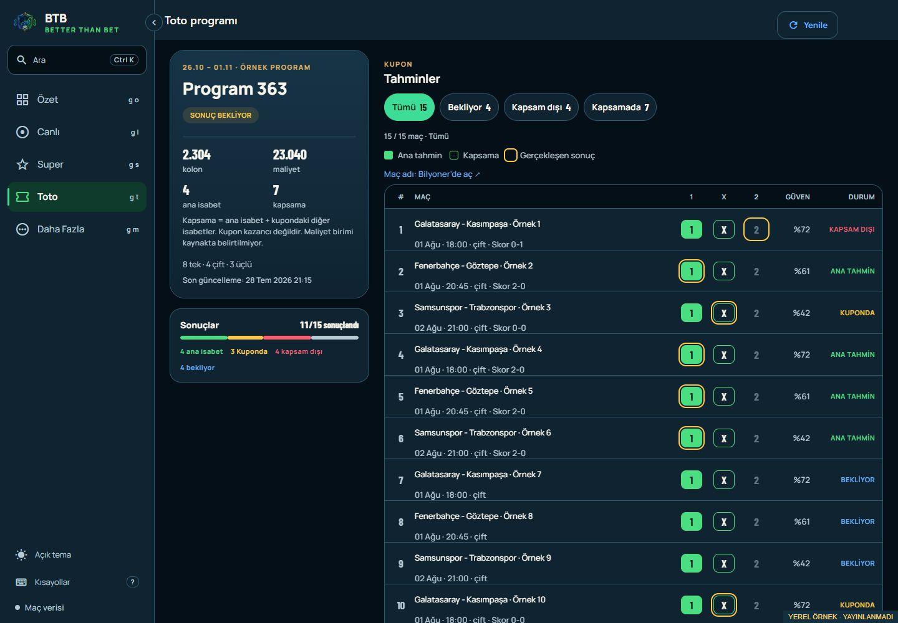

# Super Decision and Toto Program UX — 2026-10-26

Owner: BTB Mobile Next - Aktif. NXT-OBS-228/229. Extension of the local
[Super/Toto list batch](SUPER_TOTO_UX_REVIEW_2026-10-26.md).
Status: COMPLETE / BOTH_OWNER_SMOKES_ACCEPTED.

The owner requested the same expert review and meaningful improvements on the
two detail pages, followed by a later combined commit/publication phase.
Scores are heuristic judgements, not measured usability-study outcomes.

Owner subsequently accepted the concrete four-screen preview and next release
phase on 26 October ("Onaylıyorum"). Scoped commit/push, final signed pilot APK
and private delivery plus companion web publication are approved. Actual APK
installation before web publication and both owner smokes remain required.

Delivered source `67b72ac9b5dd8d55db097be85f773a35429405c1`: signed/private APK
`9A250D4B51578FB4DEC29D686A27DDC34090D0985BA792D7B377C629DF87CB20`, 50,487,329 bytes;
matching paired web tree `5BFE99C72B1B11CC9A5737200E80EC6117BAEF1D01B1F0F9F99AB36F8019166E`.
Owner accepted APK installation/basic smoke (“Kurulum tamamlandı sorun yok”).
Web published afterwards as `20261026T163408Z-67b72ac`; technical publication
checks passed. Owner confirmed published web: “Web works correctly”. Matching
`client-release.mjs complete` passed; TASK-0193 is DONE. Completion receipt:
`client-release-67b72ac-COMPLETE-2026-10-26.json`. Durable receipts/checkpoint
are in `btb-codex/docs/evidence/client-release-67b72ac-*2026-10-26.json` and
`SUPER_TOTO_RELEASE_67b72ac_2026-10-26.md`.

| Page | Before | Local candidate | Main benefit |
| --- | --- | --- | --- |
| Super Decision | 7.5/10 | 8.5/10 | Clear frozen context, honest metrics and recoverable missing data |
| Toto Program | 7/10 | 8.5/10 | Inspect pending/missed rows quickly and understand coupon encoding |

## Super Decision

Confirmed display defect: `NOT_PLAYED` fell through to the same final-score
presentation as a completed match. It now displays a dash and `oynanmadı`.
Loading and unavailable context are distinct; an actual finished 0–0 stays a
final draw. This changes no recorded decision or result accounting.

The hero now dates the recorded decision in Istanbul time, keeping its minute,
score and quote separate from current match context. The match action has a
visible destination label. Evidence puts reference counts first (`36/40`, for
example) and explicitly explains that consistency/stars are not win probability.
Existing deeper pool/ceiling notes remain available.

A failed decision read now offers error recovery rather than claiming that the
record does not exist. A genuine missing record offers the decision log. A failed
current-match refresh leaves recorded evidence available with a visible note.
Direct-link back fallback returns to Super. Pull feedback reflects a manual
refresh, while background polling continues quietly.

[Phone](evidence/SUPER_TOTO_UX_2026-10-26/super-decision-phone.png).

## Toto Program

Four filters show all, pending, missed or covered predictions. Covered includes
both main hits and covered-only hits. Counts and the visible/total match label
refer to actual prediction DTOs; the program overview remains for the complete
program. Its scope reminder appears when a filter is active. Empty filters have
a keyboard-accessible return to all matches.

The desktop coupon explains filled main picks, outlined coverage and the gold
actual-result ring. One visible caption names the external match destination.
Mobile cards show `Ana tahmin` and `Kapsama` separately, preserve result/score
labels, and wrap long match names without squeezing them between side columns.
No external Bilyoner action was executed during verification.

The summary stays beside the coupon from 1360 px; at 1200 px the table receives
the full content width. Metrics fit one row on a 390 px phone and wrap at 320 px.
Result completion uses neutral text rather than a success colour. The detail
uses the list's status colour, explains coverage versus coupon winnings, and
states that the cost unit is unspecified. It never infers a cost currency.
Direct-link back fallback returns to Toto; manual refresh feedback matches the
rest of the batch. All existing external routes and result DTOs are retained.

[Phone overview](evidence/SUPER_TOTO_UX_2026-10-26/toto-program-phone-overview.png),
[phone filtered results](evidence/SUPER_TOTO_UX_2026-10-26/toto-program-phone-results.png),
[320 px result cards](evidence/SUPER_TOTO_UX_2026-10-26/toto-program-narrow-results.png),
[light theme](evidence/SUPER_TOTO_UX_2026-10-26/toto-program-light.png).

## Evidence and remaining release work

- Type/lint, 672 client tests +32 tooling tests and brand checks pass. Three new
  focused regressions cover match-state display and Toto filtering/summary scope.
  Dependencies/native configuration are unchanged; prior Doctor20/20 reused.
- Final Android JS export and verified edge web export pass, including web mode
  and secret scanning. Local outputs are in
  `.codex-artifacts/super-toto-ux-20261026/{android,web}`. They are dirty-source
  validation artifacts, not signed/distributed release artifacts.
- Loopback preview uses the actual exported client with labelled synthetic DTOs.
  A 15-row partial program retained 11/15 settled while filters showed 4 pending
  and 7 covered rows. Keyboard empty-filter recovery restored all 15. Checked
  1200/1440 px table space, 320/390 px cards, unknown hits, unplayed match display
  and keyboard evidence disclosure, genuine missing-record recovery, active
  fixture fallback and Toto light/dark themes. Both pages had no document
  overflow at 320 px.
- Android installation/basic smoke is owner-attested. No adb, TalkBack,
  orientation or performance claim.
  No SAP, BFF, API schema, model, prediction or coupon-planning changes.
- All four list/detail pages shipped in one Android/web batch. Both actual owner
  smokes and the matching completion gate passed. TASK-0193 is closed;
  the accepted `3279a25` pair and previous recovery pair are preserved. Registered
  publication restarted the unchanged BFF; User prospective setting remains false.
