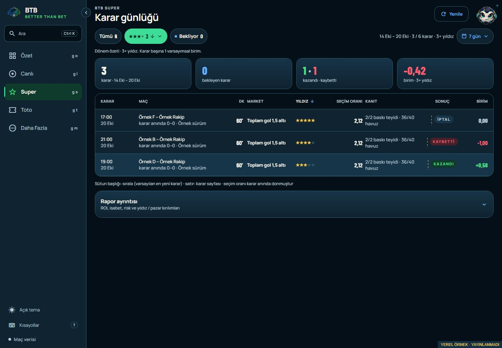
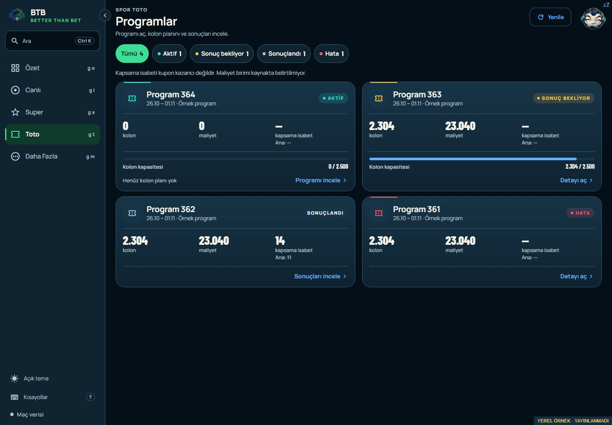

# Super and Toto UX review — 2026-10-26

Owner: BTB Mobile Next - Aktif. NXT-OBS-226 (Super), NXT-OBS-227 (Toto).
Status: OWNER_ACCEPTED_PREVIEW / APPROVED_RELEASE_PREPARATION.
Baseline: released client source `3279a25`; working-tree parent `4bb945b`.

The owner subsequently extended this same local batch to
[both detail pages](SUPER_TOTO_DETAIL_UX_REVIEW_2026-10-26.md). Final combined
validation is 672+32 passing tests and both exports; initial list-only checks
below remain historical evidence of that step. Owner accepted all four previews
and approved scoped Git and coordinated pilot delivery on 26 October. Actual
installation and client smokes are not inferred from that approval.

The owner requested an expert assessment and implementation of changes with a
material benefit, supplying desktop screenshots of both screens. Scores below
are heuristic design judgements, not usability-study or conversion evidence.

| Screen | Before | Local candidate | Main issue addressed |
| --- | --- | --- | --- |
| Super | 7.5/10 | 8.5/10 | Sorting consistency, explicit filter/summary scope and recovery |
| Toto | 7/10 | 8.5/10 | Repeated copy, history density and lifecycle-specific actions |

## Super

Confirmed issue: the star menu updated `starSort`, while the desktop table used
an independent `tableSort`. Selecting a menu sort therefore had no effect on
desktop. One shared sort state now drives both layouts. Table header changes
are reflected by the menu; a custom column order selects no false menu default.

`Tümü` clears the pending filter. Its selected state no longer implies that all
results are displayed while pending-only is active. Pending counts respect the
active star floor, and the scope names visible/period counts and active filters.
An empty intersection offers `Tüm kararları göster`; an empty short period offers
`Son 30 günü göster`. Neither changes the stored star preference.

The summary continues to use the backend's accepted period/star aggregates.
Visible copy now says one hypothetical unit per decision and explicitly explains
that pending-only narrows the list while the summary retains all results.
No result accounting, cohort handling, rating or decision rule changed.

[Phone preview](evidence/SUPER_TOTO_UX_2026-10-26/super-phone.png).

## Toto

The shared coverage/cost explanation appears once above the program list instead
of on every card. Summary's standalone Toto card retains its own explanation.
No cost currency is inferred. The screen subtitle now describes what the user
can do. Program cards display the existing main-hit value beside coverage,
preserving unknown values as a dash; the accessible label states both fully.

Capacity stays visible for active/waiting programs; completed/error cards omit
that planning-only readout. An active program with zero columns says its plan is
empty. Actions describe the destination: inspect program, inspect results or open
details. Error cards now use the existing negative tone in their icon, status
and accent instead of inheriting settled styling. Number formatting is consistent.
An empty status filter offers a direct return to all programs.

The action text and chevron stay together when the footer wraps at 320 px.
On both screens, only a user pull starts the refresh indicator; background query
polling continues without a pull-to-refresh animation.

[Phone](evidence/SUPER_TOTO_UX_2026-10-26/toto-phone.png),
[320 px](evidence/SUPER_TOTO_UX_2026-10-26/toto-narrow.png),
[light theme](evidence/SUPER_TOTO_UX_2026-10-26/toto-light.png).

## Validation and limits

- `npm run check`: TypeScript/lint, 669 client tests, 32 tooling tests and brand
  checks pass. No dependency/native configuration change; prior Doctor20/20 reused.
- Final Android JS export and `node scripts/web.mjs export --out
  .codex-artifacts/super-toto-ux-20261026/web` pass. Web embedded edge configuration
  and secret scan pass. Outputs are local dirty-source candidates, not release artifacts.
- Isolated loopback preview of the actual exported client uses clearly labelled
  synthetic DTOs, never SAP/model writes. Checked star-menu descending order
  (5,4,3), pending/star empty intersection and reset, empty-day recovery to 30
  days, preserved order across desktop/phone, Toto empty-filter recovery, all four
  lifecycle tones, unknown hits, and 320/390/1440 px layout. No document horizontal
  overflow at 320 px; Super heading starts at 24 px. Dark/light Toto inspected.
- Android receives the same components and filters; desktop's table is replaced
  by the existing native cards/pager. No device was connected: installation,
  TalkBack, native gesture/orientation and performance checks are not claimed.
- No commit/push, signing, private delivery, web publication or BFF restart for
  this new batch. The accepted `3279a25` APK/web pair and previous recovery pair
  remain intact. A future release needs scoped approvals and the coordinated
  Android/web delivery gates; earlier approvals covered the completed prior batch.

No backend, API schema, SAP, Super selection or Toto prediction/coupon behavior
was changed. Preview data and review scores establish no betting performance.
